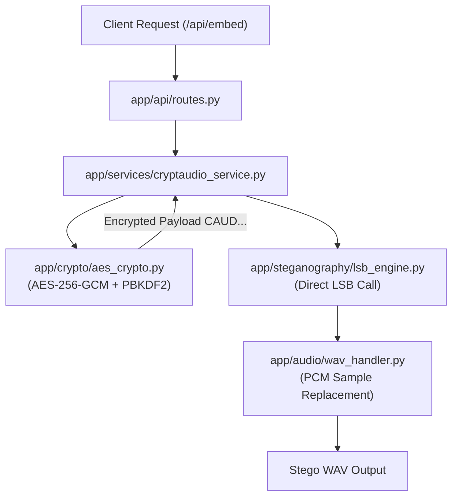
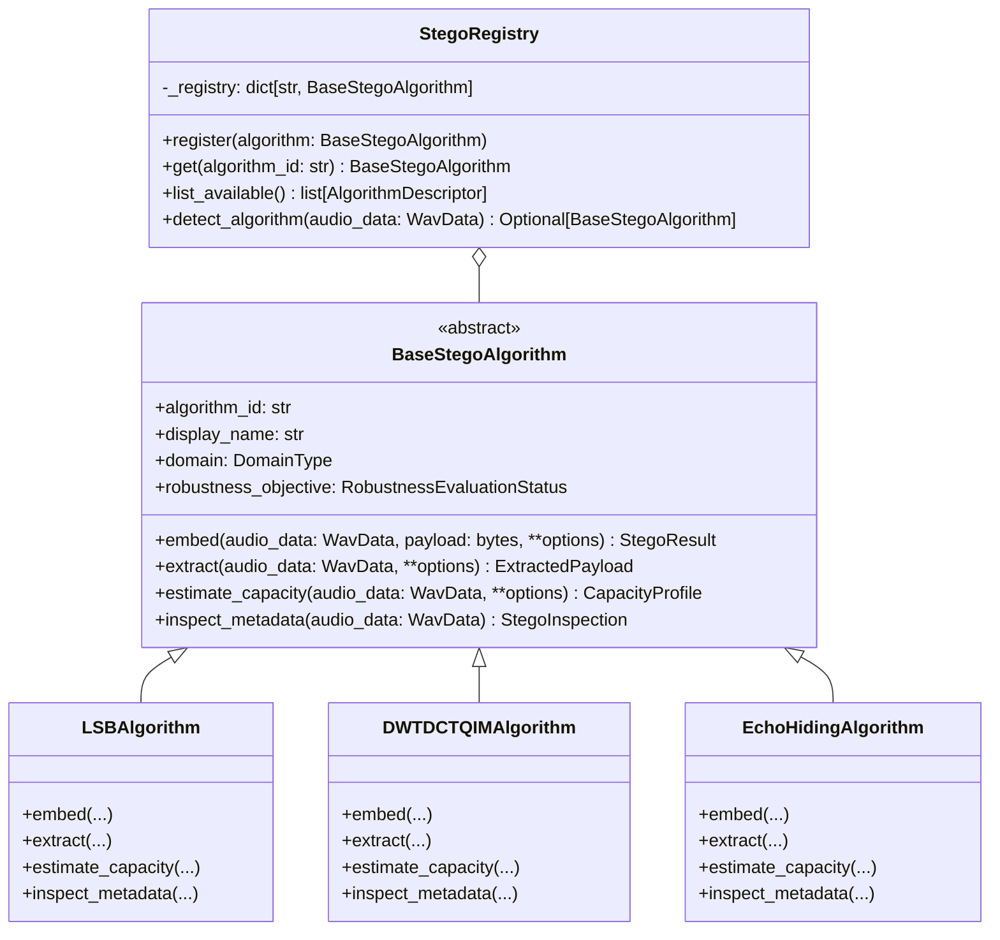
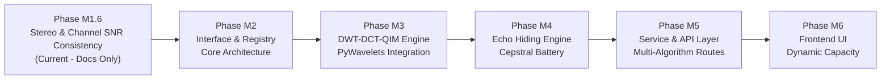

# CryptAudio-Web — Multi-Algorithm Steganography Architecture Specification (M1.6)

**Document Reference**: `MULTI_ALGORITHM_ARCHITECTURE.md`  
**Revision**: M1.6 (Final Mathematical & Stereo SNR Measurement Consistency)  
**Status**: Proposal & Technical Specification (Documentation-Only Phase)  
**Security Standard**: AES-256-GCM + PBKDF2-HMAC-SHA256 (600,000 iterations)  

---

## 1. Executive Summary & Revision History

### 1.1 Revision History & Summary of Architecture Corrections

#### Phase M1.6 Corrections (Current Revision)
1. **Separation of Single-Channel and Stereo Signal Power & SNR (Finding 1 & 2)**:
   - Formally distinguished single-channel signal power ($P_{\text{signal,ch0}} = \frac{1}{N} \sum s_{0,n}^2$) from whole-file stereo signal power ($P_{\text{signal,stereo}} = \frac{1}{2N} \sum (s_{0,n}^2 + s_{1,n}^2) = \frac{P_{\text{signal,ch0}} + P_{\text{signal,ch1}}}{2}$).
   - Defined corresponding single-channel SNR ($\text{SNR}_{\text{ch0}} = 10 \log_{10}(P_{\text{signal,ch0}} / \text{MSE}_{\text{mod}})$) and whole-file stereo SNR ($\text{SNR}_{\text{stereo}} = 10 \log_{10}(P_{\text{signal,stereo}} / \text{MSE}_{\text{stereo}})$).
   - Explicitly documented the equal-channel-power assumption ($P_{\text{signal,ch0}} \approx P_{\text{signal,ch1}}$) underpinning the retained numerical stereo SNR figures ($76.02\text{ dB}$ for $10^7$ and $26.02\text{ dB}$ for $10^2$), while specifying the general combined-power formulation for asymmetric channels.
   - Clarified all measurement conventions across modified Channel 0 MSE/SNR, whole-file stereo MSE/SNR, and container-bound PSNR ($\text{MAX} = 32767$).

#### Phase M1.5 Corrections (Retained Baseline)
1. **Canonical DWT Synchronization Sequence Standardized to `0xF9A9` (Finding 1)**:
   - Formally reconciled the custom 16-bit bipolar sequence $P_{\text{DWT}} = [+1, +1, +1, +1, +1, -1, -1, +1, +1, -1, +1, -1, +1, -1, -1, +1]$ with its unique binary and hexadecimal representations.
   - Defined the exact mapping $b_i = \frac{v_i + 1}{2} \in \{0, 1\} \iff v_i = 2b_i - 1 \in \{-1, +1\}$, mapping $+1 \mapsto 1$ and $-1 \mapsto 0$.
   - Proved the big-endian bit sequence evaluates to $\mathbf{b}_{\text{DWT\_sync}} = [1, 1, 1, 1, 1, 0, 0, 1, 1, 0, 1, 0, 1, 0, 0, 1] \implies \text{Byte 0: } \text{0xF9}, \text{Byte 1: } \text{0xA9}$, establishing the canonical 16-bit synchronization word as **`0xF9A9`** (`b"\xF9\xA9"`).
   - Replaced all obsolete references to `0x3D4F` across envelope tables, examples, capacity derivations, and detection logic.
   - Confirmed that encoder embedding and decoder sliding-window cross-correlation use the identical sequence with threshold $\tau_{\text{sync}} = 0.875$ (tolerating $\le 1$ bit error out of 16).
   - Reaffirmed that the 16-bit sequence is strictly designated as a custom bipolar pseudo-noise (PN) sequence, avoiding Barker code misnomers.
2. **Corrected SNR Arithmetic & Rigorous PSNR Distinction (Finding 2)**:
   - Corrected mathematical errors in Section 7.2:
     - For high-amplitude signal power $P_{\text{signal}} = 10^7$ with $\text{MSE}_{\text{mod}} = 0.5$: $\text{SNR} = 10 \log_{10}(10^7 / 0.5) = 10 \log_{10}(2 \times 10^7) \approx \mathbf{73.01\text{ dB}}$ (replacing the erroneous claim of $>90\text{ dB}$).
     - For low-amplitude signal power $P_{\text{signal}} = 10^2$ with $\text{MSE}_{\text{mod}} = 0.5$: $\text{SNR} = 10 \log_{10}(10^2 / 0.5) = 10 \log_{10}(200) \approx \mathbf{23.01\text{ dB}}$ (replacing the erroneous claim of $<40\text{ dB}$).
   - Clearly separated dynamic signal-dependent **SNR** ($P_{\text{signal}} / \text{MSE}$) from container-bound **PSNR** ($\text{MAX}^2 / \text{MSE}$), noting that PSNR $\approx 93.32\text{ dB}$ for 16-bit PCM solely because $\text{MAX}^2 \approx 1.0737 \times 10^9$.
   - Explicitly distinguished modified-channel MSE ($\text{MSE}_{\text{mod}} = 0.5$) from whole-file stereo MSE ($\text{MSE}_{\text{stereo}} = 0.25 \cdot U$), providing exact formulas for both.
   - Reaffirmed that neither SNR nor PSNR are static guarantees of LSB embedding.
3. **Elimination of Remaining Barker Terminology (Finding 3)**:
   - Corrected Section 5.3 diagram: replaced "Barker / Cepstral Preamble Search" with "Algorithm-specific synchronization (custom bipolar sequence / cepstral preamble detection)".
   - Verified that no section of the specification erroneously classifies the 16-bit synchronization sequence as a Barker code.
4. **Clarified Physical vs. Logical Echo Synchronization Representation (Finding 4)**:
   - Documented the mapping between the physical 16-segment delay pattern $P_{\text{echo}} = [d_0, d_1, \dots]$ and its logical 16-bit binary representation $\mathbf{b}_{\text{echo\_sync}} = [0, 1, 0, 1, 1, 0, 0, 1, 0, 1, 1, 0, 1, 0, 1, 0] \implies \mathbf{\text{0x596A}}$ (`b"\x59\x6A"`).
   - Clarified that Echo Hiding embeds synchronization physically via segment delay modulation ($d_0 = 44, d_1 = 57$ samples) across 16 segments (32,768 frames), rather than sample-level bit replacement.
   - Detailed the in-memory reconstruction of the logical 18-byte `CSMA` envelope following cepstral peak detection and envelope metadata decoding.
   - Verified that the physical 144-segment envelope budget ($16\text{ preamble} + 128\text{ metadata segments} = 144\text{ bits} = 18\text{ bytes}$) precisely preserves single-count envelope capacity accounting ($N_{\text{envelope\_bits}} = 144$).

#### Phase M1.4 Corrections (Retained Baseline)
1. **Deterministic QIM Extraction Formulation & Unified Tie-Breaking (Finding 1)**:
   - Formulated the exact modulo extraction metric $\delta_0(Y) = (Y - d_0) \bmod \Delta$, where $\bmod$ denotes Euclidean (floored) modulo evaluating strictly onto the interval $[0, \Delta)$ for all real $Y \in \mathbb{R}$ (including negative numbers).
   - Replaced conflicting interval definitions with an unambiguous decision rule:
     $$b^* = \begin{cases} 1 & \text{if } \frac{\Delta}{4} < \delta_0(Y) < \frac{3\Delta}{4} \\ 0 & \text{if } \delta_0(Y) \in \left[0, \frac{\Delta}{4}\right] \cup \left[\frac{3\Delta}{4}, \Delta\right) \end{cases}$$
   - Unified the tie-breaking convention across definitions and examples: exact decision boundary ties occur at $\delta_0(Y) = \frac{\Delta}{4}$ and $\delta_0(Y) = \frac{3\Delta}{4}$ (where $|Y - q_0(Y)| = |Y - q_1(Y)|$) and deterministically evaluate to $b^* = 0$.
   - Recalculated worked numerical examples for $\Delta = 32.0, d_0 = -8.0, d_1 = +8.0$, formally proving that halfway boundary ties deterministically return $b^* = 0$ for positive midpoints ($Y = 16.0, Y = 0.0$) and negative midpoints ($Y = -16.0, Y = -32.0$).
2. **Single-Count CSMA Envelope Overhead & Capacity Accounting (Finding 2)**:
   - Confirmed that the 18-byte (144-bit) `CSMA` v1 header format **already includes** the 2-byte (16-bit) synchronization word (`0xF9A9`) at byte offsets 0..1.
   - Eliminated the double-counting of synchronization overhead ($16 + 144 = 160$ bits in M1.3).
   - Corrected the net usable payload capacity equation to subtract the 144-bit envelope **only once**:
     $$C_{\text{net\_bytes}} = \max\left( 0, \left\lfloor \frac{C_{\text{raw}} - N_{\text{envelope\_bits}}}{8} \right\rfloor \right) = \max\left( 0, \left\lfloor \frac{C_{\text{raw}} - 144}{8} \right\rfloor \right)$$
   - Recalculated the 1.0-second 44.1 kHz DWT-DCT example: $N_{\text{chunks}} = 43 \implies C_{\text{raw}} = 688$ raw bits, $C_{\text{net\_bits}} = 688 - 144 = 544$ bits, $C_{\text{net\_bytes}} = \lfloor 544 / 8 \rfloor = 68$ bytes (replacing the previous under-counted 66 bytes).
   - Recalculated minimum duration for the minimum 49-byte payload ($536$ bits total = $392$ payload + $144$ envelope): DWT-DCT requires 34 chunks ($34,816$ samples $\approx 0.79$ s); Echo Hiding requires 536 segments ($1,097,728$ samples $\approx 24.89$ s).
   - Confirmed legacy `CSLB` framing (13-byte / 104-bit header) remains completely decoupled from `CSMA` framing.

#### Phase M1.3 Corrections (Retained Baseline)
1. **AES-GCM Terminology & Cryptographic Security Scoping (Finding 1)**:
   - Corrected all references to the authentication tag: eliminated erroneous mentions of "Poly1305" and specified the exact **128-bit AES-GCM authentication tag** (computed via GHASH over ciphertext and AAD, masked with an AES-encrypted nonce-derived block).
   - Replaced unconditional $2^{-128}$ security claims with a rigorous qualification: $2^{-128}$ represents the idealized single-attempt probability of a successful random tag guess. Practical operational security is governed by NIST SP 800-38D bounds, nonce uniqueness guarantees, invocation volumes, and verification rejection limits.
   - Decoupled steganographic synchronization detection (heuristic signal-processing frame locking) from cryptographic authentication (AES-GCM tag verification under the shared secret key), explicitly noting that synchronization detectors cannot rely on AES-GCM before decryption.
2. **Mathematically Rigorous LSB Distortion Formulation (Finding 2)**:
   - Eliminated the assertion that MSE $\le 0.5$ is an unconditional upper bound.
   - Defined the **worst-case squared error per modified sample** as $\text{SE}_{\max} = 1$ for unit-step integer sample replacement.
   - Clarified that expected squared error is approximately $0.5$ per modified sample only under the stated statistical assumption of independent, uniformly distributed payload bits relative to carrier LSBs.
   - Formulated whole-file stereo MSE accounting for the unmodified channel and channel averaging conventions. Explicitly noted that SNR and PSNR are signal-dependent and cannot be stated as fixed guarantees.
3. **Elimination of Echo Hiding Inaudibility Overclaims (Finding 3)**:
   - Removed all assertions claiming inaudibility has been achieved.
   - Reclassified inaudibility as an **engineering design objective** requiring empirical validation via objective acoustic metrics (PEAQ, ViSQOL, SNR) and subjective listening tests (ITU-R BS.1116 / MUSHRA). Acknowledged that no listening-test results currently exist for the project.
4. **Neutral Robustness Enumeration & Empirical Gates (Finding 4)**:
   - Replaced capability-implying enum values (`FILTER_RESISTANT`, `EXPERIMENTAL_ROBUST`) with neutral evaluation labels: `FRAGILE_BY_DESIGN`, `EXPERIMENTAL_TARGET`, `ROBUSTNESS_UNVERIFIED`, and `NOT_EVALUATED`.
   - Defined the mandatory evidentiary criteria required before an algorithm can be classified as robust (BER $< 10^{-4}$, repeated trials, controlled channel perturbations, reference comparisons).
5. **Precise Echo Hiding PNR & Synchronization Specification (Finding 5)**:
   - Specified an exact, reproducible Peak-to-Noise Ratio (PNR) metric with formal exclusion guard bands around target delay bins ($d_0, d_1$), background mean and standard deviation definitions, and a numerical floor ($\epsilon_{\text{floor}} = 10^{-12}$) preventing division-by-zero or non-finite outputs.
   - Defined explicit rejection conditions (low PNR, poor correlation, ambiguous secondary peaks, near-zero carrier energy, insufficient duration). Labeled all detection thresholds as proposed defaults requiring empirical calibration in Phase M4.
6. **Exact DWT-DCT Capacity Accounting & Chunk Boundary Alignment (Finding 6)**:
   - Unified the capacity estimator and embedding engine onto identical chunking logic: processing occurs strictly over complete $M = 1024$ sample frame chunks on Channel 0, with trailing incomplete samples ($N_{\text{tail}} < 1024$) bypassed unmodulated and strictly excluded from capacity.
   - Formulated exact raw and net capacity equations and provided a worked numerical example demonstrating bit-for-bit agreement between estimation and embedding.
7. **Deterministic QIM Quantization & Tie-Breaking (Finding 7)**:
   - Specified a fully deterministic quantization rounding convention using floor-offset half-up rounding: $\text{round\_half\_up}(u) = \lfloor u + 0.5 \rfloor$, eliminating language- and platform-dependent floating-point rounding ambiguities.
   - Formulated matching modulo-domain extraction and tie-breaking rules, accompanied by a worked numerical tie-case example.

#### Phase M1.2 Corrections (Retained Baseline)
- Corrected DWT-DCT correlation threshold to $\tau_{\text{sync}} = 0.875$ for $\le 1$ error on a 16-bit sequence.
- Specified the custom 16-bit bipolar synchronization sequence (avoiding "Barker code" misnomers).
- Reconciled QIM noise-tolerance boundaries: guaranteed for $|w| < \Delta/4$; unguaranteed/conditional for $|w| \ge \Delta/4$.
- Restricted LSB raw capacity to Channel 0 ($C_{\text{raw}} = N_{\text{frames}}$), aligning with the stereo policy.
- Specified orthonormal DCT-II and IDCT-II transform equations and boundary handling.
- Specified Echo Hiding continuous state buffering ($d_{\max} = 57$) and Hanning cross-fading.

#### Phase M1.1 Corrections (Retained Baseline)
- Established domain-specific synchronization strategies for LSB, DWT-DCT, and Echo Hiding.
- Defined the dual-lattice QIM model ($\Lambda_0, \Lambda_1$) and deterministic extraction.
- Reclassified channel robustness from guaranteed properties to experimental objectives.
- Specified the end-to-end PCM integer/float normalization and anti-wrap clipping pipeline.
- Framed backward compatibility with legacy `CSLB` v1 as a formal verification gate.

---

### 1.2 Architectural Scope & Invariants
CryptAudio-Web currently operates as a production web application performing authenticated cryptographic audio steganography. Its baseline implementation conceals data using 1-bit sample-level **Least Significant Bit (LSB)** replacement in uncompressed integer PCM WAV audio.

This specification designs a **modular, pluggable multi-algorithm steganography architecture**, introducing two complementary paradigms alongside LSB:
- **DWT-DCT + QIM (Transform Domain)**: Discrete Wavelet Transform coupled with Discrete Cosine Transform and Quantization Index Modulation, designed as an experimental candidate for resilience against linear filtering and noise.
- **Echo Hiding (Time Domain)**: Resonance-based sub-perceptual micro-delay embedding, designed as an experimental candidate for acoustic-channel survivability based on psychoacoustic masking principles.

#### Non-Negotiable Invariants:
- **Cryptographic Engine Intact**: AES-256-GCM and PBKDF2-HMAC-SHA256 (600,000 iterations) remain completely unchanged.
- **Payload Opacity**: Steganography algorithms receive and emit arbitrary binary bytes. The 33-byte `CAUD` header, salt, nonce, ciphertext, and 128-bit AES-GCM authentication tag are processed as an opaque binary blob.
- **Documentation-Only Scope**: No source code, tests, dependencies, API contracts, or frontend assets are modified during Phase M1.6.

---

## 2. Existing Architecture Analysis

### 2.1 Verified File Inventory
The existing application implementation comprises the following verified files:

| Subsystem | Verified File Path | Current Responsibility |
|---|---|---|
| **FastAPI Core** | `app/main.py` | Lifespan, security middleware, `/static` mount to `frontend/`, root route. |
| **API Transport** | `app/api/routes.py` | REST endpoints (`/api/health`, `/api/audio/inspect`, `/api/embed`, `/api/extract`, `/api/analyze`), upload validation. |
| **Audio I/O** | `app/audio/wav_handler.py` | RIFF/WAVE parsing, `WAVE_FORMAT_EXTENSIBLE`, 8/16/24/32-bit PCM validation, lossless reading and writing. |
| **Configuration** | `app/core/config.py` | Upload size ceilings (50 MB individual / 100 MB combined), directory paths. |
| **Cryptography** | `app/crypto/aes_crypto.py` | PBKDF2 (600,000 iterations, SHA-256), AES-256-GCM, 33-byte AAD header (`CAUD`). |
| **Quality Evaluation** | `app/evaluation/audio_quality.py` | Vectorized NumPy evaluation: MSE, SNR (dB), PSNR (dB), Pearson Correlation ($r$). |
| **Orchestration Service** | `app/services/cryptaudio_service.py` | Orchestrates `aes_crypto`, `wav_handler`, and `lsb_engine` for embed/extract workflows. |
| **Steganography Engine** | `app/steganography/lsb_engine.py` | 1-bit LSB replacement, bit packing, 13-byte `CSLB` framing, CRC32 verification. |
| **Frontend Presentation**| `frontend/index.html`<br>`frontend/css/styles.css`<br>`frontend/js/api.js`<br>`frontend/js/app.js` | Zero-framework single-page client, Light/Dark theme manager, REST API client. |
| **Automated Tests** | `tests/test_*.py` | 298 passing unit, integration, and security tests. |

### 2.2 Existing Control Flow & Coupling
Currently, `cryptaudio_service.py` is directly bound to `lsb_engine.py`:



### 2.3 Legacy Framing Protocol (`CSLB` v1)
The legacy framing protocol implemented in `app/steganography/lsb_engine.py` is structured as:

```text
Offset   Size (bytes)   Field             Format / Value
-------------------------------------------------------------------------
0        4              Magic Identifier  b"CSLB" (CryptAudio Stego LSB)
4        1              Format Version    0x01 (Version 1)
5        4              Payload Length    Big-endian uint32 (N bytes)
9        4              CRC32 Checksum    Big-endian uint32 of payload
13       N              Encrypted Payload Raw binary bytes (CAUD...)
-------------------------------------------------------------------------
Total Header Overhead: 13 bytes (104 bits)
```

**Why `CSLB` Cannot Be Blindly Extended to Transform or Time-Domain Steganography**:
1. **Spatial Assumptions**: `CSLB` assumes bit $i$ is stored in sample $i$'s LSB. In DWT-DCT, bits are modulated across frequency bands; in Echo Hiding, bits are encoded across multi-millisecond temporal segments.
2. **Lack of In-Band Preamble for Transform Domains**: Transform and echo decoders require an acoustic or transform-domain synchronization signal to detect block alignment before header bits can be recovered.
3. **No Algorithm Discriminator**: `CSLB` files do not declare the algorithm type, precluding dynamic multi-algorithm dispatch without manual selection.

---

## 3. Proposed Multi-Algorithm Architecture

### 3.1 Architecture Overview
The system introduces an abstraction layer via the **Strategy Pattern** managed by an **Algorithm Registry**:



### 3.2 Target Module Structure
```text
app/steganography/
├── __init__.py                # Strategy exports & package interface
├── base.py                    # BaseStegoAlgorithm abstract class & dataclasses
├── registry.py                # StegoRegistry singleton & factory
├── envelope.py                # CSMA envelope packing & verification utilities
├── lsb_engine.py              # Existing legacy LSB engine (100% untouched)
├── lsb_adapter.py             # Adapter wrapping lsb_engine in BaseStegoAlgorithm
├── dwt_dct_qim.py             # DWT-DCT + QIM transform-domain strategy
└── echo_hiding.py             # Echo Hiding time-domain strategy
```

---

## 4. Common Algorithm Interface Design

### 4.1 Interface Contract (`BaseStegoAlgorithm`)
Each algorithm must implement this abstract specification:

```python
"""
app/steganography/base.py (Design Specification)
"""
from abc import ABC, abstractmethod
from dataclasses import dataclass
from enum import Enum
from typing import Any, Optional, Dict
from app.audio.wav_handler import WavData

class DomainType(str, Enum):
    SPATIAL_TIME = "spatial_time_domain"
    TRANSFORM = "transform_domain"
    ACOUSTIC_TIME = "acoustic_time_domain"

class RobustnessEvaluationStatus(str, Enum):
    """
    Evaluation status of algorithm channel robustness.
    Avoids asserting unverified capabilities prior to empirical testing.
    """
    FRAGILE_BY_DESIGN = "fragile_by_design"       # LSB: altered by any bit change
    EXPERIMENTAL_TARGET = "experimental_target"   # Intended design objective
    ROBUSTNESS_UNVERIFIED = "robustness_unverified" # Verification pending
    NOT_EVALUATED = "not_evaluated"               # No empirical channel tests performed

@dataclass(frozen=True)
class CapacityProfile:
    algorithm_id: str
    available_bits: int
    available_bytes: int
    bits_per_sample: float
    bits_per_second: float
    max_payload_bytes: int
    synchronization_overhead_bits: int
    envelope_overhead_bits: int
    recommended_min_duration_sec: float

@dataclass(frozen=True)
class StegoResult:
    success: bool
    algorithm_id: str
    modified_wav: WavData
    payload_size_bytes: int
    framed_size_bytes: int
    required_bits: int
    available_bits: int
    utilization_percent: float
    algorithm_parameters: Dict[str, Any]

@dataclass(frozen=True)
class ExtractedPayload:
    success: bool
    algorithm_id: str
    payload: bytes
    integrity_verified: bool
    algorithm_parameters: Dict[str, Any]

@dataclass(frozen=True)
class StegoInspection:
    has_stego_signature: bool
    detected_algorithm: Optional[str]
    envelope_version: Optional[int]
    payload_length_bytes: Optional[int]
    confidence_score: float

class BaseStegoAlgorithm(ABC):
    """Abstract Strategy interface for all audio steganography implementations."""

    @property
    @abstractmethod
    def algorithm_id(self) -> str:
        """Unique machine identifier ('lsb', 'dwt_dct_qim', 'echo')."""
        pass

    @property
    @abstractmethod
    def display_name(self) -> str:
        """Human-readable display title."""
        pass

    @property
    @abstractmethod
    def domain(self) -> DomainType:
        """Operational domain classification."""
        pass

    @property
    @abstractmethod
    def robustness_objective(self) -> RobustnessEvaluationStatus:
        """Evaluation status of channel robustness."""
        pass

    @abstractmethod
    def embed(
        self,
        audio_data: WavData,
        payload: bytes,
        **options: Any,
    ) -> StegoResult:
        """Embed an opaque binary payload into carrier audio."""
        pass

    @abstractmethod
    def extract(
        self,
        audio_data: WavData,
        **options: Any,
    ) -> ExtractedPayload:
        """Extract concealed binary payload from stego audio."""
        pass

    @abstractmethod
    def estimate_capacity(
        self,
        audio_data: WavData,
        **options: Any,
    ) -> CapacityProfile:
        """Calculate payload capacity for the given carrier audio parameters."""
        pass

    @abstractmethod
    def inspect_metadata(
        self,
        audio_data: WavData,
    ) -> StegoInspection:
        """Non-destructive signature detection and header inspection."""
        pass
```

### 4.2 Standardized Exception Hierarchy
```text
StegoAlgorithmError (Base)
├── CapacityExceededError
├── HeaderNotFoundError
├── SynchronizationError
├── CorruptedPayloadError
├── AudioFormatIncompatibleError
├── UnsupportedParameterError
└── AlgorithmRegistryError
```

### 4.3 Evidence Criteria for Robustness Classification
No algorithm will be classified as robust against a channel perturbation (e.g., MP3 compression, AWGN, filtering, resampling) until the following empirical criteria are satisfied:
1. **Corpus Breadth**: Testing conducted across a minimum of 20 standardized audio tracks covering speech, solo instruments, full-spectrum orchestral music, and ambient field recordings.
2. **Defined Perturbations**: Controlled execution of designated degradation pipelines (e.g., LAME MP3 encoding at 128 kbps, AWGN at 30 dB SNR, Butterworth 4 kHz low-pass filtering).
3. **Statistical Success Rate**: Successful extraction rate of $\ge 99\%$ with zero bit errors in the recovered cryptographic payload across all trials.
4. **Cryptographic Tag Verification**: 100% pass rate on 128-bit AES-GCM authentication tag verification.
5. **Reference Baseline**: Objective distortion metrics (MSE, SNR, PSNR, Pearson $r$) evaluated against unmodified carrier reference tracks.

---

## 5. Domain-Specific Synchronization & Algorithm Identification

### 5.1 The Multi-Domain Synchronization Challenge
In spatial LSB steganography, bit 0 is physically located at audio sample 0. In transform and echo domains, however, bits are modulated across frequency bands or convolved across multi-millisecond blocks. **Raw sample inspection cannot decode transform or echo headers.**

Therefore, each algorithm implements an **algorithm-specific synchronization mechanism**:

```text
+-------------------+-----------------------------------+-----------------------------------+
| Algorithm         | Synchronization Domain            | Synchronization Mechanism         |
+-------------------+-----------------------------------+-----------------------------------+
| 1. LSB            | Spatial sample indices            | Deterministic header at sample 0  |
| 2. DWT-DCT + QIM  | Mid-frequency transform blocks    | Custom 16-bit bipolar cross-corr. |
| 3. Echo Hiding    | Cepstral peak delay bins          | 16-segment differential cepstrum  |
+-------------------+-----------------------------------+-----------------------------------+
```

### 5.2 Algorithm-Specific Synchronization Details

#### A. LSB Synchronization
- **Mechanism**: Strictly deterministic sample alignment.
- **Header Placement**: Bits 0 to 143 of the envelope are embedded directly into sample LSBs $s_0 \dots s_{143}$ of Channel 0 (or $s_0 \dots s_{103}$ for legacy `CSLB`).
- **Detection**: Instantaneous extraction of the first 18 bytes from Channel 0. If bytes 0–1 equal canonical `0xF9A9` and bytes 2–5 equal `b"CSMA"`, the envelope is identified. If bytes 0–3 equal `b"CSLB"`, legacy mode is triggered.

#### B. DWT-DCT + QIM Synchronization
- **Mechanism**: Transform-block sliding window cross-correlation.
- **Canonical Sequence Design**: A **custom 16-bit bipolar synchronization sequence** with low aperiodic autocorrelation sidelobes:
  $$P_{\text{DWT}} = [+1, +1, +1, +1, +1, -1, -1, +1, +1, -1, +1, -1, +1, -1, -1, +1]$$
  *(Note: Classic Barker codes exist only for lengths 2, 3, 4, 5, 7, 11, and 13. A 16-bit sequence cannot be classified as a Barker code and is strictly specified as a custom bipolar pseudo-noise (PN) sequence).*
- **Exact Binary and Hexadecimal Representation**:
  The bipolar sequence maps bijectively to binary bits via:
  $$b_i = \frac{P_{\text{DWT}}[i] + 1}{2} \in \{0, 1\} \iff P_{\text{DWT}}[i] = 2b_i - 1 \in \{-1, +1\}$$
  Where $+1 \mapsto 1$ and $-1 \mapsto 0$.
  Evaluating across indices $i = 0 \dots 15$:
  $$\mathbf{b}_{\text{DWT\_sync}} = [1, 1, 1, 1, 1, 0, 0, 1, 1, 0, 1, 0, 1, 0, 0, 1]$$
  Packed in standard network byte order (big-endian MSB-to-LSB per byte):
  - Byte 0 (bits 0..7): `11111001` = `0xF9`
  - Byte 1 (bits 8..15): `10101001` = `0xA9`
  - Canonical 16-bit Synchronization Word: **`0xF9A9`** (`b"\xF9\xA9"`).
- **Encoder and Decoder Identity**:
  - The embedding engine modulates the exact binary sequence $\mathbf{b}_{\text{DWT\_sync}}$ (via QIM) into the mid-frequency DCT coefficients ($k=3$) of the initial 16 DCT blocks of Channel 0.
  - The extraction engine decodes candidate bipolar values $\hat{v}_{i+k} = 2\hat{b}_{i+k} - 1$ and correlates against the identical reference sequence $P_{\text{DWT}}$.
- **Correlation Metric & Error Derivation**:
  For decoded bipolar bits $\hat{v}_i \in \{+1, -1\}$ ($v_i = 2\hat{b}_i - 1$):
  $$R(k) = \frac{1}{16} \sum_{i=0}^{15} P_{\text{DWT}}[i] \cdot \hat{v}_{i+k}$$
  If $e$ bit errors occur over the 16 bits, $16 - e$ bits match ($+1$) and $e$ bits mismatch ($-1$). The normalized correlation evaluates to:
  $$R = \frac{(16 - e)(+1) + e(-1)}{16} = \frac{16 - 2e}{16} = 1 - \frac{e}{8}$$
  - $e = 0\text{ errors} \implies R = 1.0$
  - $e = 1\text{ error} \implies R = \frac{14}{16} = 0.875$
  - $e = 2\text{ errors} \implies R = \frac{12}{16} = 0.750$
- **Correlation Threshold**:
  To tolerate at most one bit error ($e \le 1$) in the synchronization preamble, the threshold is strictly:
  $$\tau_{\text{sync}} = 0.875$$
- **Locking Procedure**: When $R(k) \ge 0.875$, the frame boundary is locked at block offset $k$, and `CSMA` envelope decoding commences at block $k + 16$.

#### C. Echo Hiding Synchronization & Reproducible PNR Metric
- **Preamble Sequence**: A 16-segment sequence with an alternating delay pattern:
  $$P_{\text{echo}} = [d_0, d_1, d_0, d_1, d_1, d_0, d_0, d_1, d_0, d_1, d_1, d_0, d_1, d_0, d_1, d_0]$$
  Represented as bipolar vector $\mathbf{p} \in \{-1, +1\}^{16}$ where $d_0 \rightarrow -1, d_1 \rightarrow +1$.
- **Physical vs. Logical Echo Synchronization Mapping & Envelope Reconstruction**:
  1. *Physical Representation*: The Echo Hiding preamble is physically instantiated through the specific acoustic delay injected into each of the initial 16 carrier segments ($L_{\text{seg}} = 2048$ samples each, total 32,768 frames). It is not a literal raw byte sequence written into sample LSBs.
  2. *Logical Binary Representation*: Assigning delay $d_0 \mapsto 0$ and delay $d_1 \mapsto 1$, the physical delay pattern corresponds to the 16-bit binary sequence:
     $$\mathbf{b}_{\text{echo\_sync}} = [0, 1, 0, 1, 1, 0, 0, 1, 0, 1, 1, 0, 1, 0, 1, 0]$$
     In big-endian hexadecimal notation:
     - Byte 0 (bits 0..7): `01011001` = `0x59`
     - Byte 1 (bits 8..15): `01101010` = `0x6A`
     - Logical Synchronization Word: **`0x596A`** (`b"\x59\x6A"`).
  3. *Envelope Metadata Modulation*: Immediately following the 16 preamble segments, the next 128 audio segments ($128 \times 2048 = 262,144$ samples) physically encode the remaining 128 bits (16 bytes) of the `CSMA` envelope metadata using the same delay choices ($d_0$ for bit 0, $d_1$ for bit 1).
  4. *In-Memory Envelope Reconstruction*: During extraction, once the cepstral detector locks the 16-segment boundary, the extractor decodes the subsequent 128 segments to obtain the 16 metadata bytes. The complete logical 18-byte `CSMA` envelope is reconstructed in memory:
     - Offsets 0..1 (2 bytes): Populated with `0x596A` (or normalized algorithm sync marker).
     - Offsets 2..17 (16 bytes): Populated with decoded Magic (`CSMA`), Algorithm ID (`0x03`), Version (`0x01`), Flags, Payload Length, and CRC32.
  5. *144-Bit Envelope Invariant*: The physical envelope budget is exactly $16\text{ (preamble segments)} + 128\text{ (metadata segments)} = 144\text{ segments} = 144\text{ bits} = 18\text{ bytes}$. The single-count envelope capacity formulation ($N_{\text{envelope\_bits}} = 144$) is strictly verified and physically accurate.
- **Reproducible Peak-to-Noise Ratio (PNR) Definition**:
  1. For each candidate segment $m$, compute the real cepstrum:
     $$C_m(n) = \mathcal{F}^{-1}\left\{ \ln\left| \mathcal{F}\{ x_m(n) \} \right| \right\}, \quad n \in [0, L_{\text{seg}}-1]$$
  2. To avoid non-finite values in silent frames, signal energy is sanitized prior to FFT: if $\sigma_{x_m} < 10^{-6}$, the segment is marked silent and assigned $\text{PNR}_m = 0.0$.
  3. **Candidate Lags**: The primary candidate peak values are sampled at target delay bins $d_0$ and $d_1$:
     $$V_{\text{cand}} = \max\left( C_m(d_0), C_m(d_1) \right)$$
     $$\Delta C_m = C_m(d_1) - C_m(d_0)$$
  4. **Background Region**: The background noise region $\mathcal{N}_{\text{bg}}$ is defined over the cepstral lag window $[n_{\min}, n_{\max}] = [20, 100]$ samples, explicitly excluding guard bands of $\pm 2$ samples centered at both candidate delays:
     $$\mathcal{N}_{\text{guard}} = [d_0 - 2, d_0 + 2] \cup [d_1 - 2, d_1 + 2]$$
     $$\mathcal{N}_{\text{bg}} = \{ n \in [20, 100] \mid n \notin \mathcal{N}_{\text{guard}} \}$$
  5. **Background Statistics**:
     $$\mu_{\text{bg}} = \frac{1}{|\mathcal{N}_{\text{bg}}|} \sum_{n \in \mathcal{N}_{\text{bg}}} C_m(n)$$
     $$\sigma_{\text{bg}} = \sqrt{ \frac{1}{|\mathcal{N}_{\text{bg}}|} \sum_{n \in \mathcal{N}_{\text{bg}}} \left( C_m(n) - \mu_{\text{bg}} \right)^2 }$$
  6. **PNR Formula with Numerical Floor**:
     To prevent division-by-zero on flat or synthetic cepstra, a numerical floor $\epsilon_{\text{floor}} = 10^{-12}$ is enforced:
     $$\text{PNR}_m = \frac{V_{\text{cand}} - \mu_{\text{bg}}}{\max(\sigma_{\text{bg}}, \epsilon_{\text{floor}})}$$
  7. **Cross-Correlation**:
     Normalized correlation across the 16 segments against reference $\mathbf{p}$:
     $$\rho = \frac{\sum_{m=0}^{15} \mathbf{p}[m] \cdot \Delta C_m}{\sqrt{ \left( \sum_{m=0}^{15} (\Delta C_m)^2 \right) \left( \sum_{m=0}^{15} (\mathbf{p}[m])^2 \right) + \epsilon_{\text{floor}} }}$$
- **Detection & Rejection Conditions**:
  A candidate synchronization preamble is accepted if and only if all of the following hold:
  1. Mean preamble peak prominence: $\overline{\text{PNR}} = \frac{1}{16} \sum_{m=0}^{15} \text{PNR}_m \ge \tau_{\text{PNR}}$ (proposed default $\tau_{\text{PNR}} = 3.0$).
  2. Preamble pattern correlation: $\rho \ge \tau_{\text{echo\_sync}}$ (proposed default $\tau_{\text{echo\_sync}} = 0.85$).
  3. Peak ambiguity test: If any non-candidate cepstral peak outside $\mathcal{N}_{\text{guard}}$ satisfies $C_m(n) \ge 0.90 \cdot V_{\text{cand}}$, the segment is flagged as ambiguous and rejected.
  4. Audio duration check: Carrier must contain at least 536 segments ($\approx 24.89\text{ s}$ at $44.1\text{ kHz}$) to accommodate the 144-segment `CSMA` envelope (which subsumes the 16-segment preamble) and the minimal 49-byte ($392$-segment) `CAUD` payload.
  > [!WARNING]
  > **Threshold Status**: The threshold values $\tau_{\text{echo\_sync}} = 0.85$ and $\tau_{\text{PNR}} = 3.0$ are **proposed engineering defaults requiring empirical calibration** across speech, music, and ambient recordings during Phase M4.

### 5.3 Cryptographic Authentication vs. Steganographic Synchronization
A fundamental architectural boundary exists between **heuristic signal-processing synchronization** and **cryptographic payload authentication**:

```text
[Carrier Audio] 
       │
       ▼ (Signal Processing / Heuristics)
1. Algorithm-Specific Synchronization (Custom Bipolar Sequence / Cepstral Preamble Detection)
   - Determines candidate frame boundaries.
   - Heuristic; vulnerable to false locks on complex musical waveforms.
       │
       ▼ (Envelope Check)
2. Envelope Framing & CRC32
   - Detects accidental sample drops or bit errors.
   - Low-cost non-cryptographic filter.
       │
       ▼ (Cryptographic Verification)
3. Authenticated AES-256-GCM Decryption (Shared Secret Key)
   - Verifies 128-bit authentication tag over ciphertext and 33-byte AAD.
   - Provides cryptographically sound authenticity and integrity.
```

> [!IMPORTANT]
> **Cryptographic Security Scoping**:
> - Steganographic synchronization occurs **before** authenticated decryption. The signal-processing synchronization detector **cannot rely on AES-GCM to prevent false synchronization locks**.
> - The probability $2^{-128}$ represents the idealized single-attempt chance of an attacker successfully guessing a 128-bit AES-GCM authentication tag at random.
> - Practical AES-GCM operational security is bounded by standard cryptographic constraints: strictly enforced nonce uniqueness ($os.urandom(12)$ per encryption), total invocation ceilings under a single key (NIST SP 800-38D recommends $\le 2^{32}$ invocations per key), and application-level rejection limits to mitigate online tag-guessing attacks.
> - A false synchronization lock will produce arbitrary extracted bits. When passed to the cryptographic engine, authenticated decryption will fail with `DecryptionError` due to authentication tag mismatch.

---

## 6. Multi-Algorithm Payload Envelope Design

### 6.1 Cryptographic vs. Steganographic Boundary

```text
+-----------------------------------------------------------------------------------------+
|                              OUTER STEGANOGRAPHIC ENVELOPE                              |
|  [Sync Word: 2B] [Magic: CSMA] [Algo ID] [Version] [Flags] [Payload Length] [CRC32]    |
|  +-----------------------------------------------------------------------------------+  |
|  |                    INNER CRYPTOGRAPHIC PAYLOAD (OPAQUE BYTES)                     |  |
|  |  [Magic: CAUD] [Version: 0x01] [Salt: 16B] [Nonce: 12B] [Ciphertext + 128b Tag]   |  |
|  +-----------------------------------------------------------------------------------+  |
+-----------------------------------------------------------------------------------------+
```

### 6.2 Universal Multi-Algorithm Envelope Format (`CSMA` v1)

```text
Offset   Size (bytes)   Field             Description
-----------------------------------------------------------------------------------
0        2              Sync Word         Algorithm-specific sync word:
                                          - 0xF9A9 for DWT-DCT and LSB (CSMA mode)
                                          - 0x596A for Echo Hiding (logical framing)
2        4              Magic Identifier  b"CSMA" (CryptAudio Stego Multi-Algorithm)
6        1              Algorithm ID      0x01 = LSB, 0x02 = DWT_DCT_QIM, 0x03 = ECHO
7        1              Format Version    0x01 (Version 1)
8        2              Algorithm Flags   Packed operational parameters (e.g. delta index)
10       4              Payload Length    Big-endian uint32 payload byte count (N)
14       4              CRC32 Checksum    Big-endian uint32 CRC32 of payload bytes
18       N              Payload Data      Raw binary cryptographic payload (CAUD...)
-----------------------------------------------------------------------------------
Total Header Overhead: 18 bytes (144 bits)
```

> [!NOTE]
> **Single-Count Synchronization Budget**:
> The 2-byte (16-bit) synchronization word occupies offsets 0..1 of the 18-byte envelope. It is an integral field of the header, guaranteeing that all framing, synchronization, and algorithmic metadata are encapsulated within the exact 144-bit envelope overhead. Neither synchronization preambles nor envelopes are subtracted twice.

---

## 7. Algorithm 1: LSB Replacement (Baseline Specification)

### 7.1 Mathematical Model & Channel Policy
In strict compliance with Section 11, LSB embedding operates exclusively on **Channel 0 (Left)**:
$$s'_{0, n} = 2 \cdot \lfloor s_{0, n} / 2 \rfloor + b_n \quad (\text{Channel 0})$$
Channel 1 (Right) samples remain completely unaltered ($s'_{1, n} = s_{1, n}$).

### 7.2 Rigorous Distortion & Quality Analysis
The perceptual and mathematical distortion of 1-bit LSB replacement must be evaluated with strict distinction between worst-case bounds, statistical expectations, and signal-dependent metrics:

1. **Worst-Case Per-Sample Error**:
   When replacing sample $s_n$ with sample $s'_n$ having modified LSB $b_n$, the absolute integer change is bounded by:
   $$|s'_n - s_n| \in \{0, 1\} \implies \text{SE}_{\max} = (s'_n - s_n)^2 \le 1$$
   The maximum possible squared error for any individual modified sample is **exactly 1.0**.
2. **Expected Mean Squared Error (MSE)**:
   - *Statistical Assumption*: Assume payload bits $b_n$ are independent, identically distributed, and uniformly distributed: $\Pr(b_n = 0) = \Pr(b_n = 1) = 0.5$, and uncorrelated with carrier sample LSBs.
   - Under this assumption, $\Pr(|s'_n - s_n| = 1) = 0.5$ and $\Pr(|s'_n - s_n| = 0) = 0.5$.
   - **Expected MSE over modified Channel 0 samples**:
     $$\mathbb{E}[\text{MSE}_{\text{mod}}] = 0.5 \times (1)^2 + 0.5 \times (0)^2 = 0.5$$
   - **Expected Whole-File Stereo MSE**:
     Accounting for payload utilization fraction $U \in (0, 1]$ across Channel 0 and the untouched Channel 1:
     $$\mathbb{E}[\text{MSE}_{\text{stereo}}] = \frac{1}{2 \cdot N_{\text{frames}}} \left( \sum_{n=0}^{N_{\text{frames}}-1} (s'_{0, n} - s_{0, n})^2 + 0 \right) = \frac{1}{2} \cdot (U \times 0.5) = 0.25 \cdot U$$
     In the worst case (100% payload utilization, every sample flipped): $\text{MSE}_{\text{stereo, max}} = 0.5$.
3. **Signal-Dependent Distortion Metrics (SNR vs. PSNR)**:
   To eliminate mathematical ambiguity, distinguish mono/single-channel metrics from whole-file stereo metrics, and prevent conflating signal-to-noise ratio with peak container scale, SNR and PSNR are formally defined using distinct measurement conventions:

   - **Channel 0 Average Signal Power ($P_{\text{signal,ch0}}$)**:
     $$P_{\text{signal,ch0}} = \frac{1}{N_{\text{frames}}} \sum_{n=0}^{N_{\text{frames}}-1} s_{0, n}^2$$
   - **Whole-File Stereo Average Signal Power ($P_{\text{signal,stereo}}$)**:
     Consistent with the whole-file stereo MSE definition, the average signal power across both channels of a stereo audio file is:
     $$P_{\text{signal,stereo}} = \frac{1}{2 \cdot N_{\text{frames}}} \sum_{n=0}^{N_{\text{frames}}-1} \left( s_{0, n}^2 + s_{1, n}^2 \right) = \frac{P_{\text{signal,ch0}} + P_{\text{signal,ch1}}}{2}$$
     where $P_{\text{signal,ch1}} = \frac{1}{N_{\text{frames}}} \sum_{n=0}^{N_{\text{frames}}-1} s_{1, n}^2$ is the average power of the unmodified Channel 1 (Right).

   - **Single-Channel (Channel 0) SNR**:
     $$\text{SNR}_{\text{ch0}} = 10 \log_{10}\left( \frac{P_{\text{signal,ch0}}}{\text{MSE}_{\text{mod}}} \right) \quad (\text{dB})$$
   - **Whole-File Stereo SNR**:
     $$\text{SNR}_{\text{stereo}} = 10 \log_{10}\left( \frac{P_{\text{signal,stereo}}}{\text{MSE}_{\text{stereo}}} \right) \quad (\text{dB})$$

   - **Rigorous Numerical Examples**:
     Consider expected MSE values under uniform payload distribution: $\text{MSE}_{\text{mod}} = 0.5$ on Channel 0, and whole-file $\text{MSE}_{\text{stereo}} = 0.25$ at 100% Channel 0 utilization ($U = 1.0$).
     
     1. **High-Amplitude Orchestral Track** ($P_{\text{signal,ch0}} \approx 10^7$ on 16-bit signed PCM):
        - Modified Channel 0 SNR:
          $$\text{SNR}_{\text{ch0}} = 10 \log_{10}\left( \frac{10^7}{0.5} \right) = 10 \log_{10}(2 \times 10^7) = 10 \cdot (7 + \log_{10} 2) \approx \mathbf{73.01\text{ dB}}$$
        - Whole-File Stereo SNR (under equal-channel-power assumption):
          *Equal-Channel-Power Assumption*: If both stereo channels exhibit approximately equal average signal power ($P_{\text{signal,ch0}} \approx P_{\text{signal,ch1}} = 10^7$), then:
          $$P_{\text{signal,stereo}} = \frac{10^7 + 10^7}{2} = 10^7$$
          The whole-file stereo SNR evaluates to:
          $$\text{SNR}_{\text{stereo}} = 10 \log_{10}\left( \frac{10^7}{0.25} \right) = 10 \log_{10}(4 \times 10^7) = 10 \cdot (7 + \log_{10} 4) \approx \mathbf{76.02\text{ dB}}$$
          *General Unequal-Power Formulation*: When stereo channels have unequal average power ($P_{\text{signal,ch0}} \ne P_{\text{signal,ch1}}$), $P_{\text{signal,stereo}}$ must be computed explicitly using the combined formula $\frac{P_{\text{signal,ch0}} + P_{\text{signal,ch1}}}{2}$ before evaluating $\text{SNR}_{\text{stereo}}$.
     
     2. **Low-Amplitude / Near-Silent Recording** ($P_{\text{signal,ch0}} \approx 10^2$ on 16-bit signed PCM):
        - Modified Channel 0 SNR:
          $$\text{SNR}_{\text{ch0}} = 10 \log_{10}\left( \frac{10^2}{0.5} \right) = 10 \log_{10}(200) = 10 \cdot (2 + \log_{10} 2) \approx \mathbf{23.01\text{ dB}}$$
        - Whole-File Stereo SNR (under equal-channel-power assumption):
          *Equal-Channel-Power Assumption*: With $P_{\text{signal,ch0}} \approx P_{\text{signal,ch1}} = 10^2 \implies P_{\text{signal,stereo}} = 10^2$:
          $$\text{SNR}_{\text{stereo}} = 10 \log_{10}\left( \frac{10^2}{0.25} \right) = 10 \log_{10}(400) = 10 \cdot (2 + \log_{10} 4) \approx \mathbf{26.02\text{ dB}}$$

   - **Peak Signal-to-Noise Ratio (PSNR)**:
     PSNR is bounded strictly by the container's peak representable integer dynamic range ($\text{MAX} = 32767$ for 16-bit signed PCM $\implies \text{MAX}^2 \approx 1.0737 \times 10^9$):
     $$\text{PSNR} = 10 \log_{10}\left( \frac{\text{MAX}^2}{\text{MSE}} \right) \quad (\text{dB})$$
     - Modified Channel 0 samples ($\text{MSE}_{\text{mod}} = 0.5$):
       $$\text{PSNR}_{\text{ch0}} = 10 \log_{10}\left( \frac{1.0737 \times 10^9}{0.5} \right) \approx 10 \log_{10}(2.147 \times 10^9) \approx \mathbf{93.32\text{ dB}}$$
     - Whole-file stereo audio ($\text{MSE}_{\text{stereo}} = 0.25$):
       $$\text{PSNR}_{\text{stereo}} = 10 \log_{10}\left( \frac{1.0737 \times 10^9}{0.25} \right) \approx 10 \log_{10}(4.295 \times 10^9) \approx \mathbf{96.33\text{ dB}}$$

   > [!IMPORTANT]
   > **Summary of Measurement Conventions & Non-Guarantee Rule**:
   > - **Modified Channel 0 MSE ($\text{MSE}_{\text{mod}}$)**: Measures error across modified Channel 0 samples ($\approx 0.5$ under i.i.d. bit assumption).
   > - **Whole-File Stereo MSE ($\text{MSE}_{\text{stereo}}$)**: Averages squared errors across all frames of both channels ($= 0.25 \cdot U$, where $U \in (0, 1]$ is Channel 0 utilization).
   > - **Channel 0 SNR ($\text{SNR}_{\text{ch0}}$)**: Measures ratio of Channel 0 signal power $P_{\text{signal,ch0}}$ to Channel 0 MSE.
   > - **Whole-File Stereo SNR ($\text{SNR}_{\text{stereo}}$)**: Measures ratio of combined stereo signal power $P_{\text{signal,stereo}} = \frac{P_{\text{signal,ch0}} + P_{\text{signal,ch1}}}{2}$ to stereo MSE.
   > - **PSNR ($\text{PSNR}_{\text{ch0}}, \text{PSNR}_{\text{stereo}}$)**: Measures distortion relative to the maximum container boundary ($\text{MAX} = 32767$), explaining why PSNR exceeds $90\text{ dB}$ while SNR varies widely ($23\text{ dB} \dots 76\text{ dB}$) depending on track amplitude dynamics.
   > - **Non-Guarantee Rule**: Neither SNR nor PSNR can be claimed as fixed properties of LSB steganography; both depend on carrier dynamics and empirical measurements per audio track.

---

## 8. Algorithm 2: DWT-DCT + QIM (Transform Domain Design)

### 8.1 Wavelet Decomposition
1. **Wavelet Family**: **Daubechies 4 (`db4`)** or **Haar (`haar`)**.
   - `db4` is selected for compact support, smooth boundary reconstruction, and vanishing moments, mitigating blocking artifacts.
2. **Decomposition Tree**:
   - 3-level 1D Discrete Wavelet Transform applied to Channel 0 frames:
     $$\text{Audio } x(n) \xrightarrow{\text{DWT-3}} cA_3, cD_3, cD_2, cD_1$$
3. **Sub-band Selection**:
   - **$cD_3$ detail sub-band** ($\approx 2.75\text{ kHz} - 5.5\text{ kHz}$ at $44.1\text{ kHz}$).
   - *Rationale*: Protects low-frequency pitch clarity ($cA_3$) while avoiding fragile high frequencies ($cD_1$) that are eliminated by low-pass filters and lossy compression.

### 8.2 Block Forward and Inverse Orthonormal DCT Specification
To enable unambiguous, independent implementation, the DCT transformation adheres to the **orthonormal DCT-II** convention:

#### A. Forward Orthonormal DCT-II
For a coefficient block $x = [x_0, x_1, \dots, x_{B-1}]$ of length $B = 8$:
$$X_k = \alpha_k \sum_{n=0}^{B-1} x_n \cos\left[ \frac{\pi}{B} \left( n + \frac{1}{2} \right) k \right], \quad k = 0, \dots, B-1$$
Where the orthonormal scaling factors are:
$$\alpha_0 = \sqrt{\frac{1}{B}} = \frac{1}{\sqrt{8}}, \quad \alpha_k = \sqrt{\frac{2}{B}} = \frac{1}{2} \quad (k = 1, \dots, 7)$$

#### B. Inverse Orthonormal DCT (IDCT-II / DCT-III)
The corresponding exact inverse transform reconstructing spatial coefficients $x_n$ is:
$$x_n = \sum_{k=0}^{B-1} \alpha_k X_k \cos\left[ \frac{\pi}{B} \left( n + \frac{1}{2} \right) k \right], \quad n = 0, \dots, B-1$$
Where $\alpha_0$ and $\alpha_k$ are identical to the forward scaling factors. This ensures energy conservation (Parseval's theorem) and exact inversion:
$$\text{IDCT}(\text{DCT}(x)) = x$$

#### C. Target Coefficients
Within each 8-point DCT block, embedding targets mid-frequency coefficient index $k = 3$ (or distributed over $k \in \{2, 3, 4\}$). DC ($k = 0$) and extreme high-frequency indices ($k \ge 6$) remain unaltered.

### 8.3 Exact Chunking, Boundary, and Incomplete Block Handling
1. **Integer Chunk Processing ($M = 1024$)**:
   The carrier audio on Channel 0 is processed in non-overlapping frame chunks of $M = 1024$ samples.
   - For an audio track with $N_{\text{frames}}$ samples:
     $$N_{\text{chunks}} = \left\lfloor \frac{N_{\text{frames}}}{1024} \right\rfloor$$
   - Incomplete trailing samples $N_{\text{tail}} = N_{\text{frames}} \bmod 1024$ are **passed through unmodulated**. They are not padded with synthetic data to form an extra chunk and **contribute zero bits to payload capacity**.
2. **Coefficient Mapping per Chunk**:
   Under 3-level decomposition with `mode='periodization'`, each 1024-sample chunk yields:
   $$\text{len}(cD_3) = \frac{1024}{2^3} = 128\text{ coefficients}$$
   Dividing into $B = 8$ DCT blocks:
   $$N_{\text{blocks\_per\_chunk}} = \frac{128}{8} = 16\text{ complete blocks}$$
   With $K_{\text{target}} = 1$ bit per block (coefficient $k=3$), each 1024-sample chunk stores **exactly 16 bits**.
3. **Reconstruction & Sample Preservation**:
   After inverse DCT and inverse DWT reconstruction of the $N_{\text{chunks}}$ blocks, the unmodulated $N_{\text{tail}}$ samples are appended. Output frame count strictly matches input frame count:
   $$\text{len}(x_{\text{stego}}) == N_{\text{frames}}$$

### 8.4 Reconstruction Validation Test (`test_dwt_dct_passthrough_reconstruction`)
To ensure transform correctness before steganographic modulation, Phase M3 will enforce a dedicated pass-through test:
- **Procedure**: Execute forward DWT-3 $\rightarrow$ block DCT-II $\rightarrow$ block IDCT-II $\rightarrow$ IDWT-3 without altering any coefficients.
- **Tolerances (Proposed Defaults Requiring M3 Validation)**:
  - In floating-point domain: Peak Absolute Error $\text{PAE} < 10^{-10}$, Mean Squared Error $\text{MSE} < 10^{-20}$.
  - After integer PCM rounding (16-bit): $\text{PAE} == 0$ (exact lossless bit-for-bit reconstruction) for unclipped signals, or $\le 1$ LSB in the presence of floating-point rounding.

### 8.5 Deterministic Quantization Index Modulation (DM-QIM) Specification

#### A. Quantization Lattices
For quantization step size $\Delta > 0$, the scalar quantizers for bits $b \in \{0, 1\}$ correspond to two interleaved uniform lattices $\Lambda_0$ and $\Lambda_1$:
$$\Lambda_0 = \left\{ k \cdot \Delta + d_0 \mid k \in \mathbb{Z} \right\}, \quad \Lambda_1 = \left\{ k \cdot \Delta + d_1 \mid k \in \mathbb{Z} \right\}$$
Where symmetric dither values are:
$$d_0 = -\frac{\Delta}{4}, \quad d_1 = +\frac{\Delta}{4}$$

#### B. Deterministic Embedding Equation with Half-Up Rounding
To eliminate compiler- or language-specific floating-point rounding ambiguities (such as Python's round-to-even vs. C's round-away-from-zero), the quantization operation defines an unambiguous **floor-offset half-up rounding function**:
$$\text{round\_half\_up}(u) = \lfloor u + 0.5 \rfloor \quad \forall u \in \mathbb{R}$$
Embedding coefficient $X$ with bit $b \in \{0, 1\}$ evaluates as:
$$X' = q_b(X) = \left\lfloor \frac{X - d_b}{\Delta} + 0.5 \right\rfloor \cdot \Delta + d_b$$

#### C. Extraction Equation & Modulo Domain Formulation
Given received coefficient $Y = X' + w$, maximum-likelihood extraction determines the closest lattice point:
$$b^* = \arg\min_{b \in \{0, 1\}} |Y - q_b(Y)|$$

To evaluate this efficiently without explicit multi-point search, $Y$ is projected into the shifted modulo domain relative to the $\Lambda_0$ dither reference $d_0$:
$$\delta_0(Y) = (Y - d_0) \bmod \Delta$$

where $\bmod$ denotes the standard Euclidean (floored) modulo operator, defined for all $u \in \mathbb{R}$ and $\Delta > 0$ as:
$$u \bmod \Delta = u - \Delta \left\lfloor \frac{u}{\Delta} \right\rfloor \in [0, \Delta)$$

Under this mapping:
- Every point on lattice $\Lambda_0$ satisfies $Y \in \Lambda_0 \implies (Y - d_0) = k\Delta \implies \delta_0(Y) = 0.0$.
- Every point on lattice $\Lambda_1$ satisfies $Y \in \Lambda_1 \implies (Y - d_0) = k\Delta + \frac{\Delta}{2} \implies \delta_0(Y) = \frac{\Delta}{2}$.
- The Voronoi decision boundaries separating $\Lambda_0$ and $\Lambda_1$ lie midway between target points: at $\delta_0 = \frac{\Delta}{4}$ and $\delta_0 = \frac{3\Delta}{4}$.

The optimal minimum-distance decision rule in the modulo domain is therefore:
$$b^* = \begin{cases} 1 & \text{if } \frac{\Delta}{4} < \delta_0(Y) < \frac{3\Delta}{4} \\ 0 & \text{if } \delta_0(Y) \in \left[0, \frac{\Delta}{4}\right] \cup \left[\frac{3\Delta}{4}, \Delta\right) \end{cases}$$

#### D. Deterministic Tie-Breaking Behavior & Worked Numerical Examples
If the received coefficient falls exactly on a Voronoi decision boundary, the distances to both candidate lattices are equal:
$$|Y - q_0(Y)| = |Y - q_1(Y)| \iff \delta_0(Y) \in \left\{ \frac{\Delta}{4}, \frac{3\Delta}{4} \right\}$$

To ensure 100% deterministic, cross-platform bit reconstruction, CryptAudio enforces an unambiguous tie-breaking standard:
$$\text{Deterministic Tie-Breaking Rule: } b^* = 0 \quad \text{when } |Y - q_0(Y)| = |Y - q_1(Y)|$$

Because the modulo extraction rule specifies a strict open interval $\frac{\Delta}{4} < \delta_0(Y) < \frac{3\Delta}{4}$ for bit 1, both exact boundary values ($\delta_0 = \frac{\Delta}{4}$ and $\delta_0 = \frac{3\Delta}{4}$) naturally fall into the complementary region and deterministically decode to $b^* = 0$.

**Worked Numerical Examples**:
Let step size $\Delta = 32.0$.
- Dither constants: $d_0 = -8.0$, $d_1 = +8.0$.
- Interleaved lattices:
  $$\Lambda_0 = \{ \dots, -72.0, -40.0, -8.0, 24.0, 56.0, 88.0, \dots \}$$
  $$\Lambda_1 = \{ \dots, -56.0, -24.0, 8.0, 40.0, 72.0, 104.0, \dots \}$$
- Modulo decision thresholds: $\frac{\Delta}{4} = 8.0$, $\frac{\Delta}{2} = 16.0$, $\frac{3\Delta}{4} = 24.0$.

1. **Embedding without Noise**:
   - Host coefficient $X = 8.0$, embedding bit $b = 0$:
     $$u = \frac{8.0 - (-8.0)}{32.0} = \frac{16.0}{32.0} = 0.5$$
     $$\text{round\_half\_up}(0.5) = \lfloor 0.5 + 0.5 \rfloor = 1 \implies X' = 1 \cdot 32.0 + (-8.0) = 24.0 \in \Lambda_0$$
   - Host coefficient $X = 8.0$, embedding bit $b = 1$:
     $$u = \frac{8.0 - (+8.0)}{32.0} = 0.0 \implies \text{round\_half\_up}(0.0) = 0 \implies X' = 0 \cdot 32.0 + (+8.0) = 8.0 \in \Lambda_1$$

2. **Extraction without Noise**:
   - Received $Y = 24.0$ (bit 0):
     $$\delta_0(24.0) = (24.0 - (-8.0)) \bmod 32.0 = 32.0 \bmod 32.0 = 0.0 \in [0, 8.0] \implies b^* = 0$$
   - Received $Y = 8.0$ (bit 1):
     $$\delta_0(8.0) = (8.0 - (-8.0)) \bmod 32.0 = 16.0 \bmod 32.0 = 16.0$$
     $$\text{Since } 8.0 < 16.0 < 24.0 \implies b^* = 1$$

3. **Positive Midpoint Tie ($Y = 16.0$)**:
   - Received coefficient $Y = 16.0$ lies midway between $8.0 \in \Lambda_1$ and $24.0 \in \Lambda_0$:
     $$|16.0 - 8.0| = 8.0, \quad |16.0 - 24.0| = 8.0 \quad (\text{exact tie})$$
   - Modulo evaluation:
     $$\delta_0(16.0) = (16.0 - (-8.0)) \bmod 32.0 = 24.0 \bmod 32.0 = 24.0 = \frac{3\Delta}{4}$$
   - Since $24.0$ is not strictly less than $\frac{3\Delta}{4} = 24.0$, $\delta_0 \in \left[\frac{3\Delta}{4}, \Delta\right) \implies b^* = 0$.
   - **Result**: Deterministically resolves to $b^* = 0$.

4. **Zero Midpoint Tie ($Y = 0.0$)**:
   - Received coefficient $Y = 0.0$ lies midway between $-8.0 \in \Lambda_0$ and $+8.0 \in \Lambda_1$:
     $$|0.0 - (-8.0)| = 8.0, \quad |0.0 - 8.0| = 8.0 \quad (\text{exact tie})$$
   - Modulo evaluation:
     $$\delta_0(0.0) = (0.0 - (-8.0)) \bmod 32.0 = 8.0 \bmod 32.0 = 8.0 = \frac{\Delta}{4}$$
   - Since $8.0$ is not strictly greater than $\frac{\Delta}{4} = 8.0$, $\delta_0 \in \left[0, \frac{\Delta}{4}\right] \implies b^* = 0$.
   - **Result**: Deterministically resolves to $b^* = 0$.

5. **Negative Midpoint Tie 1 ($Y = -16.0$)**:
   - Received coefficient $Y = -16.0$ lies midway between $-24.0 \in \Lambda_1$ and $-8.0 \in \Lambda_0$:
     $$|-16.0 - (-24.0)| = 8.0, \quad |-16.0 - (-8.0)| = 8.0 \quad (\text{exact tie})$$
   - Modulo evaluation under Euclidean floored division:
     $$\delta_0(-16.0) = (-16.0 - (-8.0)) \bmod 32.0 = -8.0 \bmod 32.0 = -8.0 - 32.0 \cdot \lfloor -8.0 / 32.0 \rfloor = -8.0 - 32.0(-1) = 24.0 = \frac{3\Delta}{4}$$
   - Since $24.0 \in \left[\frac{3\Delta}{4}, \Delta\right) \implies b^* = 0$.
   - **Result**: Deterministically resolves to $b^* = 0$.

6. **Negative Midpoint Tie 2 ($Y = -32.0$)**:
   - Received coefficient $Y = -32.0$ lies midway between $-40.0 \in \Lambda_0$ and $-24.0 \in \Lambda_1$:
     $$|-32.0 - (-40.0)| = 8.0, \quad |-32.0 - (-24.0)| = 8.0 \quad (\text{exact tie})$$
   - Modulo evaluation under Euclidean floored division:
     $$\delta_0(-32.0) = (-32.0 - (-8.0)) \bmod 32.0 = -24.0 \bmod 32.0 = -24.0 - 32.0 \cdot \lfloor -24.0 / 32.0 \rfloor = -24.0 - 32.0(-1) = 8.0 = \frac{\Delta}{4}$$
   - Since $8.0 \in \left[0, \frac{\Delta}{4}\right] \implies b^* = 0$.
   - **Result**: Deterministically resolves to $b^* = 0$.

#### E. Noise Tolerance Analysis
The distance between nearest reconstruction points of opposing lattices is $d_{\min} = \Delta/2$. Under additive perturbation $w$:
- **Strictly Guaranteed Region**: If $|w| < \frac{\Delta}{4}$, correct decoding is **strictly mathematically guaranteed** under ideal scalar QIM, because the perturbed coefficient cannot cross the Voronoi boundary into an adjacent lattice cell.
- **Unguaranteed Region**: If $|w| \ge \frac{\Delta}{4}$, correct decoding is **no longer guaranteed**; a bit decision error may occur depending on the magnitude and direction of the perturbation vector.

#### F. Quantization Step ($\Delta$) Configuration & Parameter Recovery
- **Proposed Default**: $\Delta = 32.0$ (scaled to 16-bit integer representation).
  > [!WARNING]
  > **Validation Requirement**: $\Delta = 32.0$ and its estimated $\text{SNR} \approx 42\text{ dB}$ are **proposed defaults requiring experimental validation** across diverse musical, speech, and ambient audio corpora during Phase M3.
- **Parameter Recovery**: The 2-byte Algorithm Flags field in the `CSMA` header stores an index pointing to a standardized step-size codebook ($\Delta \in \{8.0, 16.0, 32.0, 64.0\}$), enabling track-level tuning while guaranteeing deterministic extraction.

---

## 9. Algorithm 3: Echo Hiding (Time Domain Design)

### 9.1 Psychoacoustic Principle & Objective
Echo Hiding is designed to minimize perceptual distortion through low-amplitude delayed replicas and controlled segment processing, leveraging the precedence (Haas) effect for micro-delays $\Delta t < 2.0\text{ ms}$.

> [!IMPORTANT]
> **No Guaranteed Inaudibility**:
> Inaudibility is an **engineering design objective, not a guaranteed property**. Perceptual transparency depends on carrier dynamics, spectral density, and listening conditions, and must be validated through objective audio-quality measurements and subjective listening tests (ITU-R BS.1116).

### 9.2 Echo Delay & Attenuation Parameters
1. **Delays** (at $F_s = 44.1\text{ kHz}$):
   - **Bit 0**: Delay $\delta_0 = 1.0\text{ ms} \implies d_0 = 44\text{ samples}$.
   - **Bit 1**: Delay $\delta_1 = 1.3\text{ ms} \implies d_1 = 57\text{ samples}$.
2. **Attenuation ($\alpha$)**:
   - Proposed default: $\alpha = 0.08$ ($-22\text{ dB}$ relative to carrier).

### 9.3 Segment Boundary Handling & Continuous State Memory
When applying echo delay filter $h_b(n) = \delta(n) + \alpha \cdot \delta(n - d_b)$, delayed samples at the beginning of a segment reference samples from the previous segment. To ensure acoustic continuity:

1. **State Memory Buffer**:
   The embedding engine maintains a continuous history buffer storing the trailing $d_{\max} = 57$ samples of segment $m-1$. For segment $m$, delayed samples $x(n - d)$ for $n < d$ are drawn directly from this buffer:
   $$x_{\text{delayed}}(n) = \begin{cases} x_{m-1}(L_{\text{seg}} - d + n) & \text{if } n < d \\ x_m(n - d) & \text{if } n \ge d \end{cases}$$
2. **Smooth Windowing & Cross-Fading**:
   To prevent phase discontinuity clicks across block boundaries with differing delay values ($d_{\text{prev}} \ne d_{\text{curr}}$), a smooth Hanning cross-fade is applied over the initial $N_{\text{fade}} = 200$ samples:
   $$y_m(n) = x_m(n) + \alpha \left[ w_{\text{fall}}(n) x(n - d_{\text{prev}}) + w_{\text{rise}}(n) x(n - d_{\text{curr}}) \right] \quad (n < N_{\text{fade}})$$
   $$y_m(n) = x_m(n) + \alpha \cdot x(n - d_{\text{curr}}) \quad (n \ge N_{\text{fade}})$$
   Where $w_{\text{rise}}(n) = 0.5 \left(1 - \cos\left(\frac{\pi n}{N_{\text{fade}}}\right)\right)$ and $w_{\text{fall}}(n) = 1.0 - w_{\text{rise}}(n)$.
3. **First Segment Treatment ($m = 0$)**:
   The history buffer is initialized with zeros (silence) for $n < 0$.
4. **Last Segment & Sample-Count Preservation**:
   The echo is strictly truncated at the exact final audio frame count ($N_{\text{frames}}$). **No trailing echo decay is appended beyond the file boundary**, ensuring $\text{len}(y) == \text{len}(x)$.
5. **Extraction Compatibility**:
   Cepstral transformation is computed over the interior stationary region $[N_{\text{fade}}, L_{\text{seg}}-1]$ of each segment (or windowed with Hanning taper), isolating pure delay peaks from cross-fade boundary transitions.

### 9.4 Cepstral Extraction
Extraction is performed blindly via the **Real Cepstrum**:
$$C(n) = \mathcal{F}^{-1} \left\{ \ln \left| \mathcal{F} \left\{ y_m(n) \right\} \right| \right\}$$
$$\text{Decision Rule: } b^* = \begin{cases} 0 & \text{if } C(d_0) > C(d_1) \\ 1 & \text{if } C(d_1) > C(d_0) \\ 0 & \text{if } C(d_0) == C(d_1) \quad (\text{deterministic tie-break}) \end{cases}$$

### 9.5 Experimental Robustness Objectives & Required Testing Battery
> [!CAUTION]
> **No Absolute Survivability Guarantees**:
> Compression resistance and acoustic-channel survivability are **experimental objectives**, not guaranteed operational properties. Performance depends heavily on carrier dynamics, spectral density, and compression bitrates.

During Phase M4, Echo Hiding and DWT-DCT-QIM will be subjected to the following mandatory test battery:
1. **Additive Noise**: AWGN evaluated across SNR steps from $60\text{ dB}$ down to $25\text{ dB}$.
2. **Linear Filtering**: Butterworth low-pass ($4\text{ kHz}, 8\text{ kHz}$) and high-pass ($300\text{ Hz}$) filtering.
3. **Resampling**: Conversion cycles ($44.1\text{ kHz} \rightarrow 48\text{ kHz} \rightarrow 44.1\text{ kHz}$ and $44.1\text{ kHz} \rightarrow 22.05\text{ kHz} \rightarrow 44.1\text{ kHz}$).
4. **MP3 Compression**: CBR encoding at $320\text{ kbps}$, $256\text{ kbps}$, $192\text{ kbps}$, $128\text{ kbps}$, and $96\text{ kbps}$.
5. **Reverberation & Acoustic Simulation**: Multipath acoustic channel simulation using synthetic room impulse responses ($RT_{60} \in [0.1\text{ s}, 0.5\text{ s}]$).
6. **Audio Segmentation & Cropping**: Random front and rear sample trimming to verify synchronization recovery.

---

## 10. Parametric Capacity Derivation & Theoretical vs. Measured Bounds

Capacity cannot be described by a single static number. It must be derived mathematically from carrier parameters, chunking rules, and algorithm overhead.

### 10.1 Capacity Mathematical Formulation
For an audio file with duration $T$ (seconds), sampling rate $F_s$ (Hz), total audio frames $N_{\text{frames}} = T \cdot F_s$, and Channel 0 embedding:

$$\text{LSB: } C_{\text{raw}} = N_{\text{frames}} \quad (\text{bits})$$
*(Channel 0 only; Channel 1 preserved untouched).*

$$\text{DWT-DCT: } C_{\text{raw}} = \left\lfloor \frac{N_{\text{frames}}}{1024} \right\rfloor \times 16 \quad (\text{bits})$$
*(Strict integer chunking: incomplete trailing frames $N_{\text{frames}} \bmod 1024$ are bypassed unmodulated and excluded).*

$$\text{Echo Hiding: } C_{\text{raw}} = \left\lfloor \frac{N_{\text{frames}}}{2048} \right\rfloor \quad (\text{bits})$$
*(Segment size $L_{\text{seg}} = 2048$ samples on Channel 0).*

### 10.2 Net Usable Payload Capacity Formulation
The **Net Usable Payload Capacity** ($C_{\text{net\_bytes}}$) accounting for envelope and synchronization overhead is:

$$C_{\text{net\_bytes}} = \max\left( 0, \left\lfloor \frac{C_{\text{raw}} - N_{\text{envelope\_bits}}}{8} \right\rfloor \right)$$

Where:
- $N_{\text{envelope\_bits}} = 144\text{ bits}$ (18 bytes for `CSMA` v1).

> [!IMPORTANT]
> **Single-Count Synchronization Accounting**:
> As specified in Section 6.2, the 18-byte (144-bit) `CSMA` v1 header format **already includes** the 2-byte (16-bit) synchronization word (`0xF9A9` for DWT-DCT, or 16 preamble segments representing `0x596A` for Echo Hiding) at byte offsets 0..1. The synchronization overhead is therefore subsumed within the 144-bit envelope overhead and **must not be subtracted a second time**.
>
> **Legacy Framing Decoupling**:
> Legacy `CSLB` v1 framing (13 bytes / 104 bits) is utilized exclusively when operating in legacy backward-compatibility mode under `LSBAlgorithm`. It is completely decoupled from `CSMA` v1 and is never combined with or added to `CSMA` overhead calculations.

Total Header Overhead Summary:
- **LSB (`CSMA` mode)**: $144\text{ bits} = 18\text{ bytes}$ (using canonical sync word `0xF9A9`).
- **LSB (Legacy `CSLB` mode)**: $104\text{ bits} = 13\text{ bytes}$ (retained exclusively for legacy backward-compatibility).
- **DWT-DCT-QIM (`CSMA` mode)**: $144\text{ bits} = 18\text{ bytes}$ (16-bit canonical sync word `0xF9A9` at offsets 0..1 + 128-bit header metadata).
- **Echo Hiding (`CSMA` mode)**: $144\text{ bits} = 18\text{ bytes}$ (16 preamble delay segments representing `0x596A` at offsets 0..1 + 128-bit header metadata).

### 10.3 Worked Numerical Example: Estimator vs. Embedder Agreement
Consider a 16-bit stereo PCM WAV file sampled at $44.1\text{ kHz}$ with duration $T = 1.0\text{ second}$:
- Total frames: $N_{\text{frames}} = 44,100$.
- Channel policy: Channel 0 modulated; Channel 1 untouched.

1. **DWT-DCT Chunk Calculation**:
   $$N_{\text{chunks}} = \left\lfloor \frac{44100}{1024} \right\rfloor = 43\text{ complete chunks} \implies 43 \times 1024 = 44,032\text{ samples}$$
   $$N_{\text{tail}} = 44,100 - 44,032 = 68\text{ trailing samples (bypassed unmodulated)}$$

2. **Raw Capacity**:
   $$C_{\text{raw}} = 43 \times 16 = 688\text{ raw bits}$$

3. **Net Available Payload Capacity**:
   $$C_{\text{net\_bits}} = C_{\text{raw}} - N_{\text{envelope\_bits}} = 688 - 144 = 544\text{ bits}$$
   $$C_{\text{net\_bytes}} = \left\lfloor \frac{544}{8} \right\rfloor = 68\text{ bytes}$$

4. **Embedding Agreement**:
   The embedding loop processes exactly 43 chunks $\times$ 16 blocks $= 688$ blocks:
   - The first 16 blocks (16 bits / 2 bytes) store the 16-bit canonical synchronization word (`0xF9A9`).
   - The next 128 blocks (128 bits / 16 bytes) store the remaining `CSMA` header fields (magic `CSMA`, algorithm ID, version, flags, payload length, and CRC32).
   - Together, these first 144 blocks account for the complete 18-byte `CSMA` envelope.
   - The remaining 544 blocks store exactly 68 payload bytes ($544 / 8 = 68$).
   - The trailing 68 samples are appended unmodulated.
   
   Both the capacity estimator and the embedding loop agree **bit-for-bit**.

### 10.4 Required Minimum Duration for Smallest Payload
The smallest valid CryptAudio payload is 49 bytes (33-byte `CAUD` header + 16-byte AES-GCM authentication tag with 0-byte plaintext).  
Net required bits to embed: $N_{\text{req}} = (49 \times 8) + 144 = 392 + 144 = 536\text{ bits}$ (67 bytes total).

| Algorithm | Raw Bit-Rate ($44.1\text{ kHz}$) | Channel Policy | Header Overhead | Net Throughput | Min Audio Duration for Min Payload (49B CAUD) |
|---|---|---|---|---|---|
| **LSB** | $44,100\text{ bps}$ | Channel 0 only | 144 bits (18B) | $\approx 5,510\text{ B/s}$ | $\approx 0.012\text{ seconds}$ ($536\text{ frames}$) |
| **DWT-DCT-QIM** | $\approx 689.1\text{ bps}$ | Channel 0 only | 144 bits (18B) | $\approx 86.1\text{ B/s}$ | $\approx 0.79\text{ seconds}$ ($34\text{ chunks} = 34,816\text{ frames}$) |
| **Echo Hiding** | $\approx 21.5\text{ bps}$ | Channel 0 only | 144 bits (18B) | $\approx 2.69\text{ B/s}$ | $\approx 24.89\text{ seconds}$ ($536\text{ segments} = 1,097,728\text{ frames}$) |

> [!NOTE]
> All throughput rates above represent **theoretical upper bounds** based on idealized mathematical models. Actual net capacity and decoding reliability under real-world acoustic conditions will be empirically benchmarked during Phases M3 and M4.

---

## 11. End-to-End PCM Audio Processing Pipeline

To guarantee lossless audio container integrity and prevent distortion artifacts:

```text
Input WAV (8/16/24/32-bit PCM)
       │
       ▼
1. Unpack to Integer Samples (wav_handler.py)
       │
       ▼
2. Normalize to Float64 in [-1.0, +1.0]
       │
       ▼
3. Transform / Steganographic Embedding (DWT-DCT / Echo / LSB on Channel 0)
       │
       ▼
4. Denormalize to Original Quantization Scale
       │
       ▼
5. Strict Anti-Wrap Clamping: np.clip(round(s), min_val, max_val)
       │
       ▼
6. Re-pack to Original Integer PCM Bit-Depth (wav_handler.py)
       │
       ▼
Output WAV (Exact Bit-Depth, Exact Sample Count, Valid Header)
```

### 11.1 Pipeline Specifications

1. **Floating-Point Normalization**:
   Integer PCM samples are converted to double-precision float (`float64`) scaled by the maximum representable amplitude:
   - 8-bit unsigned: $x_{\text{float}} = (s - 128.0) / 128.0 \in [-1.0, 1.0)$
   - 16-bit signed: $x_{\text{float}} = s / 32768.0 \in [-1.0, 1.0)$
   - 24-bit signed: $x_{\text{float}} = s / 8388608.0 \in [-1.0, 1.0)$
   - 32-bit signed: $x_{\text{float}} = s / 2147483648.0 \in [-1.0, 1.0)$
2. **Reconstruction & Anti-Wrap Clamping**:
   Inverse transforms produce floating-point values that may slightly exceed representation limits due to filter overshoot. **Direct integer casting without clamping causes catastrophic arithmetic wrap-around** (e.g., $+32768 \rightarrow -32768$, creating loud clicks).
   The engine enforces strict clipping:
   $$s_{\text{clamped}} = \text{np.clip}\left( \text{np.round}(s_{\text{reconstructed}}), S_{\min}, S_{\max} \right)$$
3. **Container Bit-Depth Preservation**:
   The output WAV container strictly preserves the exact sample width (1, 2, 3, or 4 bytes) and channel count of the input carrier.
4. **Stereo & Multi-Channel Handling**:
   - Embedding is performed strictly on **Channel 0 (Left)**.
   - **Channel 1 (Right) is preserved bit-for-bit without modification.**
   - Dual-channel embedding (interleaved or joint-stereo) is reserved for future extensions.
5. **Exact Sample-Count Invariant**:
   The output stego WAV must contain **exactly the same number of audio frames** as the input:
   $$\text{len}(W_{\text{out}}.\text{frames}) == \text{len}(W_{\text{in}}.\text{frames})$$
   Zero sample truncation or trailing zero-padding is permitted.

---

## 12. Dependency Assessment & Deployment Considerations

### 12.1 Dependency Baseline & Candidates

| Library | Status | Purpose | Python 3.13 Wheel | Memory / Disk Impact | Recommendation |
|---|---|---|---|---|---|
| **PyWavelets (`pywavelets`)** | Candidate | C-optimized DWT/IDWT filter banks | Available on PyPI (v1.8.0+) | Small (~4 MB wheel) | **Recommended for M3** |
| **SciPy (`scipy`)** | Candidate | DCT-II and DSP routines | Available on PyPI (v1.14.0+) | Large (~60 MB wheel, build RAM) | **Omit (NumPy alternative used)** |

### 12.2 Pure NumPy Realization for DCT & Cepstrum
To maintain a lean deployment profile on Render (which enforces 512 MB starter RAM limits), DCT-II and Real Cepstral transformations will be implemented in pure NumPy:
- **Orthonormal DCT-II via FFT**:
  ```python
  def dct2_ortho_numpy(x: np.ndarray) -> np.ndarray:
      N = len(x)
      v = np.empty(2 * N, dtype=np.float64)
      v[:N] = x
      v[N:] = x[::-1]
      V = np.fft.fft(v)
      k = np.arange(N)
      factor = np.exp(-1j * np.pi * k / (2 * N))
      out = np.real(factor * V[:N])
      # Orthonormal scaling: alpha_0 = sqrt(1/N), alpha_k = sqrt(2/N)
      out[0] *= np.sqrt(1.0 / N) / 2.0
      out[1:] *= np.sqrt(2.0 / N) / 2.0
      return out
  ```
- **Real Cepstrum via FFT**:
  ```python
  def real_cepstrum(x: np.ndarray) -> np.ndarray:
      spectrum = np.fft.fft(x)
      return np.real(np.fft.ifft(np.log(np.maximum(np.abs(spectrum), 1e-12))))
  ```

---

## 13. Comprehensive Testing Strategy

```text
+---------------------------------------------------------------------------------+
|                               TESTING MATRIX                                    |
+-------------------+-------------------------------------------------------------+
| Test Group        | Objective                                                   |
+-------------------+-------------------------------------------------------------+
| 1. Roundtrip      | Zero-error payload recovery for LSB, DWT-DCT, and Echo      |
| 2. Rejection      | Extracting with wrong algorithm fails gracefully (HTTP 422) |
| 3. Capacity       | Short audio raises CapacityExceededError before embedding   |
| 4. Channel Noise  | AWGN tolerance evaluated across SNR 60dB -> 25dB            |
| 5. Resampling     | Verification under 44.1kHz <-> 48kHz sampling conversions   |
| 6. Audio Quality  | MSE, SNR, PSNR, Pearson r calculated across all engines     |
| 7. Tamper Defense | 128-bit AES-GCM tag verification rejects corrupt payloads   |
| 8. Legacy Gates   | Existing 298 tests and CSLB v1 fixtures pass unmodified     |
| 9. Reconstruction | Zero-distortion pass-through validation for DWT/DCT filters  |
+-------------------+-------------------------------------------------------------+
```

---

## 14. Backward Compatibility Verification Gates

> [!IMPORTANT]
> **Strict Verification Gate**:
> 100% backward compatibility is **an architectural requirement that must be empirically verified**. It is not claimed as an achieved fact until the following gates pass:
> 1. All 298 existing pytest tests must pass without modification.
> 2. Legacy audio fixtures embedded with the Phase 1–12 `CSLB` v1 protocol must successfully extract using the new unified `extract_payload()` pipeline.
> 3. Zero regressions in the 15/15 manual E2E test workflow.

---

## 15. Phased Implementation Roadmap



- **Phase M1.6 (Current)**: Mathematical resolution of single-channel ($P_{\text{signal,ch0}}$, $\text{SNR}_{\text{ch0}}$) vs. whole-file stereo ($P_{\text{signal,stereo}}$, $\text{SNR}_{\text{stereo}}$) signal power and SNR metrics, documentation-only deliverable.
- **Phase M2**: Implementation of `BaseStegoAlgorithm`, `StegoRegistry`, `UniversalEnvelope`, and `LSBAdapter`.
- **Phase M3**: Implementation of `DWTDCTQIMAlgorithm` and PyWavelets integration.
- **Phase M4**: Implementation of `EchoHidingAlgorithm` and cepstral analysis test suite.
- **Phase M5**: Orchestration updates in `cryptaudio_service.py` and API routes.
- **Phase M6**: Frontend UI algorithm selector and capacity breakdown indicators.

---

## 16. Conclusion

Phase M1.6 resolves the remaining mathematical ambiguity in audio quality metrics, formally defining single-channel versus whole-file stereo signal power and SNR while documenting the equal-channel-power assumption for the retained numerical examples. The specification provides an unambiguous, mathematically verified, and internally consistent architectural foundation for multi-algorithm steganography while preserving CryptAudio-Web's cryptographic invariants, local and cloud compatibility, and zero-defect quality baseline.

**Current Status**: Complete. Awaiting user authorization before initiating Phase M2.
