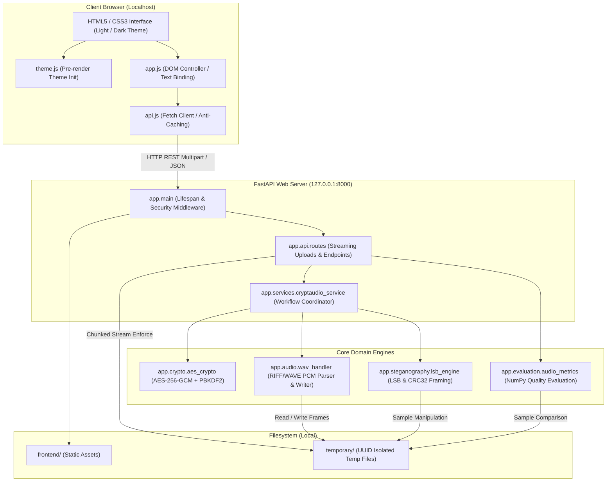

# CryptAudio-Web — System Architecture

## 1. Architectural Overview

CryptAudio-Web is structured as a modular, local-first web application designed for secure cryptographic audio steganography and distortion analysis. The system strictly separates concerns across the presentation tier, API transport tier, coordination service layer, and specialized domain engines.

---

## 2. Layer Descriptions

### A. Presentation Layer (`frontend/`)
- **Technology**: HTML5, CSS3, Vanilla JavaScript (ECMAScript 2022). Zero frontend frameworks.
- **Components**:
  - `index.html`: Responsive single-page dashboard featuring technical overview, embedding, extraction, audio inspection, and quality analysis views. Enforces strict zero-inline script policy.
  - `css/styles.css`: CSS custom properties supporting default Light Theme and Dark Theme toggle, responsive grids, and layout rules.
  - `js/theme.js`: Synchronously loaded in `<head>` to read `localStorage` and set `data-theme` prior to initial DOM rendering, eliminating Flash of Unstyled Content (FOUC).
  - `js/api.js`: Thin HTTP abstraction wrapping `fetch` for `/api/health`, `/api/audio/inspect`, `/api/embed`, `/api/extract`, and `/api/analyze`.
  - `js/app.js`: Application logic handling tab navigation, file drop zones, capacity calculation, audio playback, and rendering dynamic text content strictly via `textContent` and `createElement`.

### B. Transport & Gateway Layer (`app/main.py`, `app/api/routes.py`)
- **Technology**: FastAPI 0.115+, Uvicorn, Starlette.
- **Components**:
  - `app/main.py`: Application entry point. Configures:
    - `lifespan`: Startup and shutdown lifecycle purging orphaned `.wav` files from `temporary/`.
    - `security_headers_middleware`: Injects strict browser security headers (`nosniff`, `DENY`, `no-referrer`, anti-caching on `/api/*`, and a strict Content Security Policy restricting scripts to `'self'`).
    - `global_exception_handler`: Formats unhandled exceptions into the unified API error envelope.
  - `app/api/routes.py`: Implements REST endpoints:
    - `GET /api/health`: Health status, application name, version.
    - `POST /api/audio/inspect`: WAV container metadata and raw embedding capacity.
    - `POST /api/embed`: Encryption and sample-level LSB embedding into carrier audio.
    - `POST /api/extract`: Extraction and authenticated AES-GCM decryption.
    - `POST /api/analyze`: Numerical distortion metrics comparison between original and stego audio.
  - Streaming File Uploads: `save_upload_safely()` consumes chunked multipart streams up to 50 MB per file (100 MB combined) with immediate HTTP 413 rejection upon limit exceedance.

### C. Service Coordination Layer (`app/services/cryptaudio_service.py`)
- Coordinates the three underlying engines:
  - Validates input paths, carrier audio parameters, non-empty passwords, and message length.
  - Pre-calculates exact cryptographic and framing overhead (62 bytes fixed overhead) to enforce capacity constraints before executing steganography.
  - Invokes cryptographic key derivation and authenticated encryption.
  - Executes LSB replacement embedding and generates the stego WAV.
  - Re-validates generated stego WAV integrity prior to returning results.
  - Handles extraction and authenticated decryption, catching format, framing, and decryption exceptions cleanly.

### D. Core Domain Engines

1. **Cryptographic Engine (`app/crypto/aes_crypto.py`)**:
   - **Key Derivation**: PBKDF2-HMAC-SHA256 with 600,000 iterations, 16-byte cryptographically secure random salt, generating a 256-bit (32-byte) symmetric key.
   - **Authenticated Encryption**: AES-256-GCM with a fresh 12-byte random initialization vector (nonce).
   - **Header Authentication**: Complete 33-byte header (`CAUD` magic + version byte + 16B salt + 12B nonce) is authenticated as Additional Authenticated Data (AAD), preventing header tampering.
   - **Authentication Tag**: 16-byte (128-bit) GCM tag appended to ciphertext.

2. **Audio Processing Engine (`app/audio/wav_handler.py`)**:
   - **Container Validation**: `_verify_riff_wave_format()` validates low-level RIFF/WAVE chunks.
   - **Format Support**: Mono and stereo uncompressed integer PCM (8-bit, 16-bit, 24-bit, 32-bit).
   - **Extensible Format**: Supports `WAVE_FORMAT_EXTENSIBLE` (0xFFFE) with `KSDATAFORMAT_SUBTYPE_PCM` GUID; strictly rejects IEEE float GUID and partial bit depths (e.g. 18 valid bits in 24-bit container).
   - **Sample Width Preservation**: Preserves raw frame bytes without lossy resampling or normalization.

3. **LSB Steganography Engine (`app/steganography/lsb_engine.py`)**:
   - **Embedding Strategy**: Replaces least-significant bit (bit 0) of each PCM audio sample byte with 1 bit of payload.
   - **Framing Structure**: 13-byte header (`CSLB` magic + version byte + 4B length + 4B CRC32) preceding payload bytes.
   - **Integrity**: Standard IEEE 802.3 32-bit CRC detects accidental transmission bit corruption.
   - **Zero-Modification Trailing**: Samples beyond required payload bits remain untouched.

4. **Audio Quality Evaluation Module (`app/evaluation/audio_metrics.py`)**:
   - **Numerical Processing**: High-performance NumPy array vectorized computations.
   - **Metrics Computed**:
     - Mean Squared Error (MSE).
     - Signal-to-Noise Ratio (SNR) in decibels (dB).
     - Peak Signal-to-Noise Ratio (PSNR) in decibels (dB).
     - Pearson Correlation Coefficient ($r$).
   - **Categorization**: Automatic perceptual assessment classification (e.g. `Excellent` for PSNR $\ge 40$ dB and $r \ge 0.9999$).
