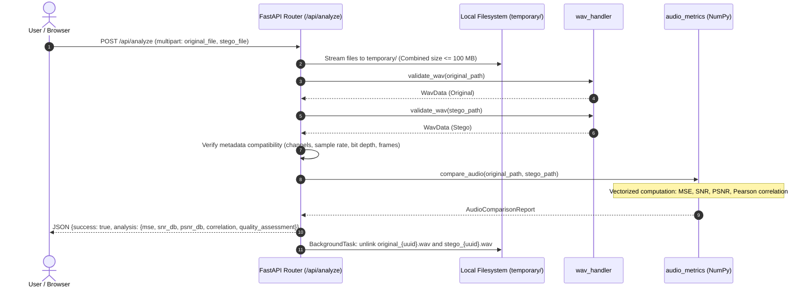

# CryptAudio-Web — Data Flow Documentation

This document describes the step-by-step data flows across the presentation layer, REST API endpoints, service layer, and domain engines for the three core workflows.

---

## 1. Workflow 1: Message Embedding and Encryption

Converts a plaintext Unicode message and a carrier PCM WAV file into an encrypted, steganographically encoded stego WAV file.

```mermaid
sequenceDiagram
    autonumber
    actor User as User / Browser
    participant API as FastAPI Router (/api/embed)
    participant FS as Local Filesystem (temporary/)
    participant Svc as cryptaudio_service
    participant Audio as wav_handler
    participant Crypto as aes_crypto
    participant Stego as lsb_engine

    User->>API: POST /api/embed (multipart: carrier file, message, password)
    API->>FS: Stream carrier to temporary/carrier_{uuid}.wav (<= 50 MB)
    API->>Svc: embed_message(input_wav, output_wav, message, password)
    
    Svc->>Audio: read_wav(input_wav)
    Audio-->>Svc: WavData (metadata, raw frame bytes)
    
    Svc->>Crypto: encrypt_message(message, password)
    Note over Crypto: PBKDF2 (600,000 iter) -> 32B Key; AES-256-GCM encrypt
    Crypto-->>Svc: encrypted_payload (33B header + ciphertext + 16B tag)
    
    Svc->>Svc: Pre-check capacity: len(encrypted_payload) + 13B <= available samples
    
    Svc->>Stego: embed_payload(input_wav, output_wav, encrypted_payload)
    Note over Stego: Frame binary (CSLB 13B header) and embed 1 bit per sample LSB
    Stego->>FS: Write stego_{uuid}.wav
    Stego-->>Svc: EmbedResult (utilization %, modified samples)
    
    Svc->>Audio: inspect_wav(output_wav)
    Audio-->>Svc: Validate generated stego WAV
    Svc-->>API: EmbedMessageResult
    
    API->>User: Stream stego audio file download (Content-Disposition: attachment)
    API->>FS: BackgroundTask: unlink carrier_{uuid}.wav and stego_{uuid}.wav
```

### Exact Framing and Payload Transformations
1. **Plaintext Message**: Arbitrary UTF-8 string $M$, length $L = \text{len}(M_{\text{UTF-8}})$.
2. **Key Derivation**: $K = \text{PBKDF2-HMAC-SHA256}(\text{Password}, \text{Salt}_{16\text{B}}, 600000, 32)$.
3. **AES-GCM Encryption**:
   - Header (33 bytes) = `CAUD` (4B) + `0x01` (1B) + $\text{Salt}$ (16B) + $\text{Nonce}$ (12B).
   - $\text{Ciphertext}, \text{Tag}_{16\text{B}} = \text{AES-GCM-Encrypt}(K, \text{Nonce}, M_{\text{UTF-8}}, \text{AAD}=\text{Header})$.
   - Crypto Payload = Header || Ciphertext || Tag (16B) (Total: $L + 49$ bytes).
4. **LSB Framing**:
   - LSB Header (13 bytes) = `CSLB` (4B) + `0x01` (1B) + $\text{Payload Length}_{4\text{B}}$ + $\text{CRC32}_{4\text{B}}$.
   - Framed Stream = LSB Header || Crypto Payload (Total: $L + 62$ bytes).
5. **Sample-Level LSB Replacement**:
   - Total required samples = $(L + 62) \times 8$.
   - Bit $j$ of framed stream replaces bit 0 of carrier sample byte $j$.

---

## 2. Workflow 2: Message Extraction and Decryption

Extracts the binary payload from a stego PCM WAV file and decrypts the original message using the user's password.

```mermaid
sequenceDiagram
    autonumber
    actor User as User / Browser
    participant API as FastAPI Router (/api/extract)
    participant FS as Local Filesystem (temporary/)
    participant Svc as cryptaudio_service
    participant Stego as lsb_engine
    participant Crypto as aes_crypto

    User->>API: POST /api/extract (multipart: stego file, password)
    API->>FS: Stream stego file to temporary/stego_{uuid}.wav (<= 50 MB)
    API->>Svc: extract_message(stego_wav, password)
    
    Svc->>Stego: extract_payload(stego_wav)
    Note over Stego: Read 13B Framing Header; Verify CSLB magic and CRC32; Read N payload bytes
    Stego-->>Svc: raw_encrypted_payload
    
    Svc->>Crypto: decrypt_message(raw_encrypted_payload, password)
    Note over Crypto: Parse 33B Header; PBKDF2 -> 32B Key; AES-256-GCM authenticated decrypt
    alt Correct Password
        Crypto-->>Svc: Plaintext Unicode string
        Svc-->>API: Extracted message string
        API-->>User: JSON {success: true, message: "..."}
    else Incorrect Password or Tampered Payload
        Crypto-->>Svc: DecryptionError (GCM authentication tag mismatch)
        Svc-->>API: MessageExtractionError
        API-->>User: HTTP 422 {success: false, error: {code: "AUTHENTICATION_FAILED", message: "..."}}
    end
    API->>FS: BackgroundTask: unlink stego_{uuid}.wav
```

### Authentication Failure Mechanics
- If an adversary alters even a single bit of the carrier audio in the payload region, or provides an incorrect password, AES-GCM tag verification fails.
- The decryption function catches `cryptography.exceptions.InvalidTag` and immediately raises `DecryptionError`.
- No partial plaintext or decrypted fragments are ever returned to the caller or logged.

---

## 3. Workflow 3: Audio Quality Analysis

Quantifies distortion introduced by LSB steganography by comparing the original carrier WAV against the stego WAV.


